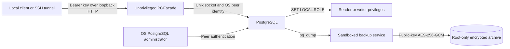

# Security and verification record

Scope: the reference single-host PGFacade deployment, its authentication and permission model, and its maintenance workflow. Verified on Ubuntu 24.04 with PostgreSQL 16 and system Python 3.12. This is a scoped code/deployment review, not an exhaustive penetration test or a claim that a compromised host is safe.

## Trust boundaries

Root, the PostgreSQL OS administrator, reviewed source, and custom query files are trusted. The facade holds its reader and writer roles' combined authority. It has no password, owner membership, SUPERUSER, CREATEDB, CREATEROLE, REPLICATION, or BYPASSRLS privilege. Different application trust levels require separate connectors and deployments.

## Enforced controls

| Control | Category | Enforcement |
|---|---|---|
| Network authentication is mandatory | CWE-306 | Network factories reject missing authentication configuration; a stdio session without keys runs as the connector user; authenticated operations reject missing/wrong keys. |
| Privileged capabilities are opt-in | CWE-250 | Optional capabilities default off; explicit principals required. |
| MCP HTTP authenticates each request | CWE-287 | Explicit HTTP request context; HTTP tool calls never use the stdio key. |
| Notification and diagnostic operations enforce their capability | CWE-862 | Send/listen/watch and diagnostic catalog operations enforce their capability. Discovery omits admin-only queries for restricted callers. |
| Request size and upload duration are bounded | CWE-400 | Actual received bytes capped at 1 MiB; body-read timeout is 10 seconds. |
| Credentials stay out of validation output | CWE-532 | Key sources validate before settings construction; failures are redacted for inline and file configuration. |
| External effects cannot run inside a batch or transaction | CWE-664 | Migration operations, backend cancellation/termination, and query-cache reload are rejected before batch/transaction side effects. Disabled on the deployed profile independently. |
| Deployment gates hold under optimized Python | CWE-754 | Explicit runtime failures remain under `python -O`; regression test executes an unhealthy checker with optimization enabled. |
| The credential-bearing checker ignores proxies and redirects | CWE-201 | Environment proxies disabled; redirects refused. Loopback regression confirms no bearer reaches a redirect target. |
| The runtime environment is not writable by the service | CWE-732 | Runtime environment is root-owned with group/other write access removed; host check enforces it. |
| Updates and test setup are scripted | Operational | Reviewed snapshot updater, full scratch-database test helper, host checks, and synthetic rollback tests are included in the checkout. |

Source regressions are in [test_security.py](../tests/integration/test_security.py), [test_transaction_safety.py](../tests/unit/test_transaction_safety.py), and [test_deployment_checks.py](../tests/integration/test_deployment_checks.py). Updater activation/rollback tests are in [deploy/tests/test-update](tests/test-update).

## Verification

[deploy/test](test) runs the full Python suite against a unique scratch database and removes it afterwards. [deploy/update](update) runs lint, formatting, and database-independent tests before building a release. [deploy/tests/test-update](tests/test-update) exercises updater success and failed-acceptance rollback.

Group-policy tests cover default deny, explicit deny precedence, connector/table scope, identifier truncation rejection, role selection and ambiguous grants, bounded atomic batches, and database role binding. Mock lookup tests cover unknown credentials, spoofed group/role headers, concurrency, and REST/MCP authentication. YAML/TOML tests cover equivalent example configurations, source precedence, validation, redaction, and safe YAML loading. No Google lookup is implemented. The deployed profile continues using existing API keys; group mode is an explicit configuration opt-in. See [the policy contract](../docs/access-control.md) for its supported operations and trusted schema effects.

Optional startup-command tests cover `READY` on stdout/stderr, exact marker matching, split writes, timeout, cancellation, noisy-process cleanup, and REST/MCP database startup ordering. No command is configured in the deployed profile.

The transport contract uses typed request envelopes and a discriminated success/error outcome. Regression tests cover REST/MCP schemas and parity, validation/authentication/routing/body-limit errors, secret-safe failures, native MCP error flags, and SSE notification/error payloads. Enum regressions verify all operation tags, registry coverage, and unchanged JSON/discriminator mappings for `Operation`, `Outcome`, and `ErrorCode` StrEnums. Direct Python calls return the same typed envelopes.

Live acceptance checks cover:

- Each named key's health, database role, read-only mode, allowed operation discovery, and disabled capabilities.
- Missing/wrong keys, raw SQL, DDL, role management, migrations, notifications, SSE, diagnostics, lifecycle, and oversized requests denied.
- The listener is exactly 127.0.0.1:8765 and owned by the systemd main process; PostgreSQL has no TCP listener.
- Individual service startup status, sandbox settings, installed-unit equality, system interpreter, root ownership, and credential metadata.
- Exact PostgreSQL peer/HBA policy, passwordless connector, restricted role attributes/memberships, no runtime object ownership or schema CREATE, and no PUBLIC database CONNECT/TEMP. The optional `pgfacade_operator` login is accepted only when passwordless, unprivileged, a member of `pgfacade_reader` alone, and limited to the `pgfacade` database.
- Recent successful encrypted backups and minimum disk reserve.

Live grant checks additionally exercised a disposable owner-created table: reader writes were denied by PostgreSQL itself, writer rows were visible to the reader, forbidden mixed batches made no changes, other databases rejected the connector, the wrong OS user failed peer authentication, and server-file/program privileges were denied. Service and PostgreSQL restart recovery were exercised; a full machine reboot was not performed.

Recovery checks decrypt/authenticate an actual encrypted archive before restoring it into a disposable database, verify owner/default grants, and reject modified ciphertext. The backup program writes no plaintext dump to disk. Encryption authenticates integrity but does not sign the backup creator.

A dependency advisory scan is point-in-time; repeat it when changing the lockfile. Runtime dependencies are hash-verified during installation.

## Coverage and limits

| Area | Evidence or limit |
|---|---|
| Authentication/authorization | Source regressions, restricted live API checks, database role/HBA checks |
| Injection and SQL boundaries | Bound-value/identifier regression suite; raw SQL/DDL disabled for this deployment |
| Crypto and data protection | Protected credentials, peer transport, encrypted backup restore/corruption checks |
| Infrastructure | systemd, listener ownership, code permissions, update/rollback checks |
| Supply chain | Locked/hash-verified runtime dependencies; advisory check is point-in-time |
| Business logic/atomicity | Batch preflight and external-effect regression tests; application-specific tenant rules are outside this empty schema |
| Browser/UI | No application UI deployed; generated docs and OpenAPI metadata remain local/public |

In the deployed API-key profile, PostgreSQL public catalog metadata remains readable through normal table APIs. No tenant RLS policies are configured. MCP HTTP is not deployed; its discovery remains unauthenticated even though tools authenticate. Resource limits are guardrails, not complete hostile-workload quotas. Shared PostgreSQL still shares CPU, memory, storage and administrator authority.

## Required operator decisions

- Configure encrypted off-server backup copies, a separately controlled recovery-key copy, and external failure alerts. Local archives do not cover loss or compromise of this server or provide point-in-time recovery.
- Monitor storage: `check-host` warns at 90% usage and rejects less than 10 GiB free; it does not deliver continuous alerts or enforce a database quota.
- Provision a unique credential for each real client and only its required database permissions. Bootstrap verification keys should not become shared application credentials.

See the [operations guide](README.md). Re-review when adding an application trust boundary, raw SQL, public network access, MCP HTTP, extensions, migrations, or sensitive tenant data.
